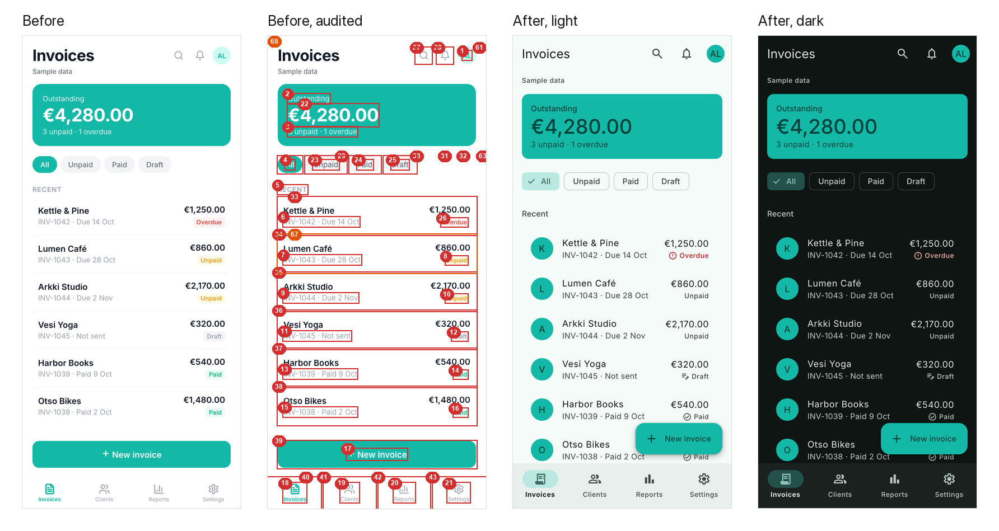
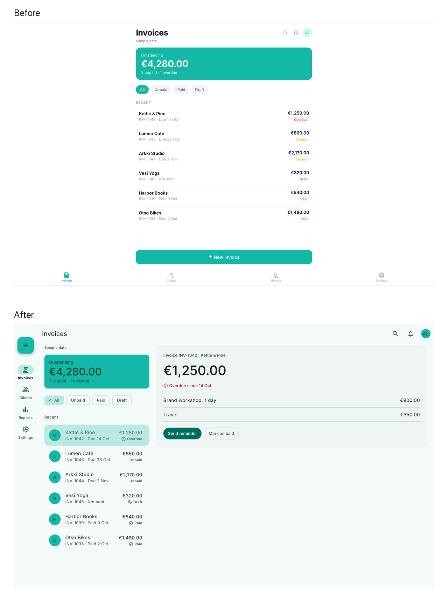
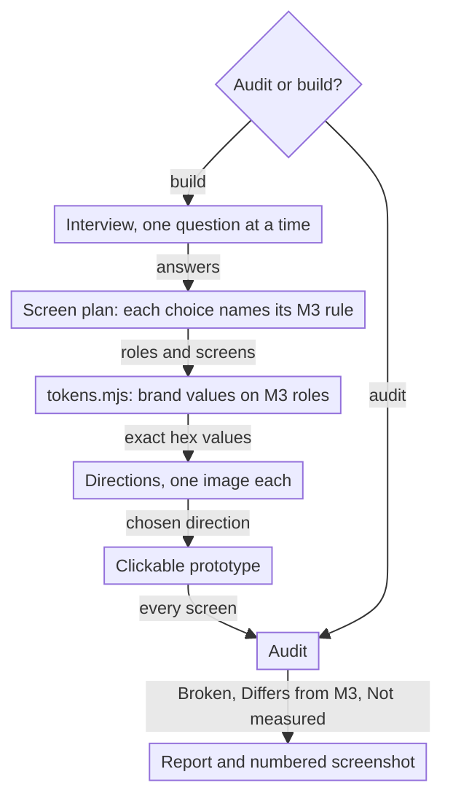

# material-3

material-3 is a Claude Code skill. It designs and audits interfaces with the rules of Google Material 3 (M3), and the
brand keeps its own look.

## Before and after

The example is an invented invoice app. The "before" screen is plain HTML and CSS, made by hand without M3. It looks
finished, but the audit found 66 Broken findings in it. Then the skill designed the screen again with the same brand
teal (`#14B8A6`), the same typeface (Inter) and the same invoices. On a desktop, the M3 layout also shows the open
invoice.



On the audited screen, each red number is a Broken finding and each orange number is a Differs from M3 finding.

| | Before | After |
|---|---|---|
| Broken findings | 66 | 0 on all 5 screens, in light and in dark |
| Text on the brand teal | white, 2.49:1 | `#00423B`, 4.58:1 |
| Gray text | `#9CA3AF` on white, 2.54:1 | `#3C4947` on `#F4FBF8`, 8.94:1 |
| Keyboard focus | not visible on 17 controls | visible on each control |
| Hover state | none on 17 controls | on each control |
| Touch targets | 28 px icon buttons, 30 px filter buttons | 48 px or more |
| Desktop layout | one phone-width column, with a tab bar across the full width | a navigation rail, and the list and the open invoice side by side |
| Dark theme | none | from the same brand config |

The brand teal stays exact. The skill locked it as the `primaryContainer` role and changed only the text color on it.
After the redesign, each audit gives one Differs from M3 finding: the typeface. Inter is the brand typeface, so it
stays.



The files of the example are in `examples/before-after/`. All names and numbers in it are sample data. To make the
screenshots and the audits again, run this command from the skill folder:

```bash
python3 examples/before-after/build.py
```

The command takes about ten minutes, because it does 11 audits in real Chrome.

## Install

Clone the repository into the skills folder of Claude Code. Then install the Node packages, the Python packages and
the WebKit browser:

```bash
git clone https://github.com/eskokoivula/material-3-skill ~/.claude/skills/material-3
npm --prefix ~/.claude/skills/material-3/scripts ci
python3 -m pip install playwright pillow
python3 -m playwright install webkit
```

## Usage

The skill starts when a request names Material 3, M3, Material Design, Material You, M3 Expressive or "Google Design".
It also starts when a request asks for a design in the style of Google. First, the skill asks one question: audit
something, or build something?

```
Design a habit tracker app in Material 3. Brand colors: #FF8A3D on #101418.
M3 audit: https://example.com
Make an M3 Flutter theme from our brand colors and keep them exact.
Google Design Audit for this screenshot.
```

You can also run the scripts without Claude. Run them from the skill folder:

```bash
node scripts/tokens.mjs brand.json --out tokens
node scripts/prototype.mjs brand.json --out prototype
python3 scripts/audit_web.py https://example.com --out audit
python3 scripts/audit_image.py screen.png boxes.json --out audit
python3 scripts/audit_flutter.py path/to/flutter-app --out audit
```

`references/brand-first.md` gives the format of the config file. The header of `scripts/audit_image.py` gives the
format of the boxes for an image audit.

## What it does



- **Screen plan.** The skill writes an M3 screen plan. The plan gives the layout for each window size, the navigation,
  the components and the emphasis. Each choice names its M3 rule.
- **Tokens.** The skill makes tokens from the brand. The color library of Google makes all 49 color roles, and the
  locked values of the brand stay exact. The script measures each required contrast pair. The type, shape, elevation, state
  and motion values come from the token files of Google. The output is CSS custom properties, a Flutter `ThemeData`
  (`m3_tokens.dart`) and a report.
- **Prototype.** The skill makes the chosen direction into a clickable prototype on `templates/m3.css`. The prototype
  has phone and desktop sizes, light and dark themes, and M3 transitions. Each state is one click away. The prototype
  obeys the reduced-motion setting.
- **Audit.** The skill audits a web page in headless Chrome, an image, or Flutter code. It puts the findings into two
  lists:
  - **Broken:** faults for any brand. Examples are low contrast of text and icons, small targets, focus that you
    cannot see, and no hover state. Other examples are movement that ignores the reduced-motion setting, a video
    that you cannot pause, and the WCAG 2.2 violations that axe-core finds. The audit measures icon fonts, and SVG
    icons that are the only content of a control, from pixels.
  - **Differs from M3:** style choices, for example the typeface, or corner radii and spacing that are not on the
    scales of M3.

  A third part, **Not measured**, names each item that a check cannot judge.
- **Numbered screenshot.** The audit draws a numbered marker on a full-page screenshot for each finding on an element.
  A finding for the full page has no marker, for example a type scale with too many sizes.

## What it does not do

- It does not design a logo, a brand identity, an illustration or a film. It does not design the story or the hero
  section of a website.
- On a website, it designs only the interface layer: navigation, buttons, forms, cards, type, color roles, states and
  interface motion. It tells the user about this limit.
- It does not change an audited project until the user says yes.
- It does not write product copy. The UI text comes from the project. All other text is a marked placeholder.
- It does not use Material Web components, because that library is in maintenance mode. The web output is plain CSS.
- For an image, it measures contrast from pixels, so the result is an estimate. For Flutter, it reads the code and
  does not run the app.

## Requirements

- Node.js 20.6 or later, and Python 3.10 or later.
- Google Chrome. The web audit uses it in headless mode through Playwright.
- Optional: a Flutter SDK. One check analyzes the generated Dart theme with it. Without the SDK, that check does not
  run.
- Optional: an image-generation skill for the direction images. Without it, the skill draws each direction as an HTML
  screen.

## Checks

Run all checks from the skill folder:

```bash
python3 tests/run_all.py
```

The command runs 12 checks. A full run takes a few minutes, because the audit opens real browsers.

- **Color engine:** all 98 roles map to the right palette and tone of Google. 5,060 colors are equal to
  `ColorScheme.fromSeed` of Flutter (5 seeds, 9 variants, both modes, 3 contrast levels).
- **Locked colors:** locked brand colors stay exact. For each locked pair that fails, the report gives the nearest
  tone that passes.
- **Web audit:** on a test page, the audit finds all 24 planted faults, each in the right list. It reports none of the
  10 traps that look like faults but are not.
- **Dialog:** with a dialog open, the audit measures only the dialog.
- **Template:** the screens of the template have no Broken finding at 390x844 and 1440x900.
- **axe-core:** the audit and axe-core agree on 146 contrast ratios, with a largest difference of 0.01.
- **Flutter scan:** the scan finds the planted faults in an invented sample app.
- **Prototype:** in Chrome and WebKit, a click reaches each screen of the template. The theme switch, the dialog focus
  and the reduced-motion setting work.
- **Dart theme:** the generated `m3_tokens.dart` gives 0 issues under `flutter analyze`.
- **Image audit:** on 2x images, each measured contrast ratio is within 0.3 of the true ratio.

## License

MIT. The Google token files in `tests/fixtures/google/` keep their own licenses (BSD-3-Clause, Apache-2.0). Read
`THIRD_PARTY_NOTICES.md` for the details. Material Design and Material 3 belong to Google. This project is not
affiliated with Google.
