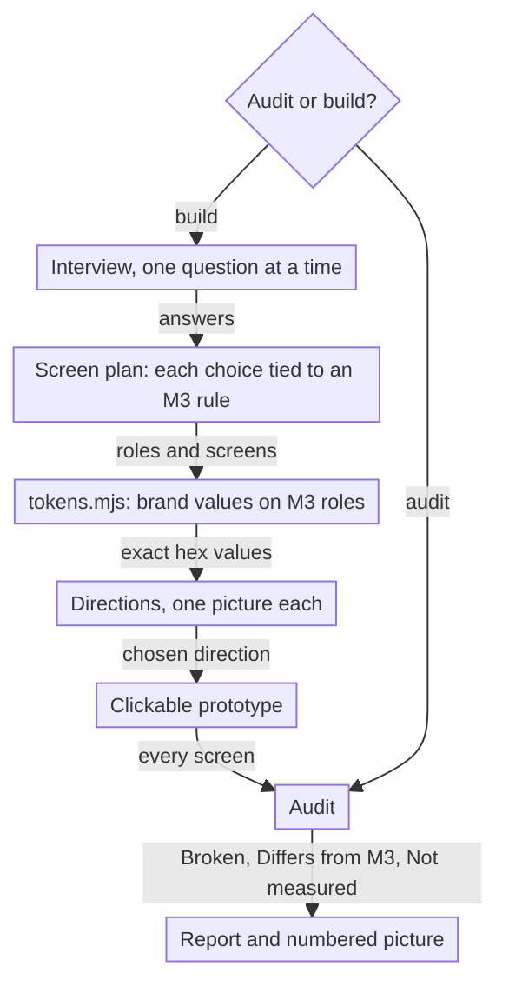

# material-3

A Claude Code skill that designs and audits interfaces the Google Material 3 way while the brand keeps its own look.

## Install

```bash
git clone https://github.com/eskokoivula/material-3-skill ~/.claude/skills/material-3
npm --prefix ~/.claude/skills/material-3/scripts ci
pip install playwright pillow
python3 -m playwright install webkit
```

## Usage

The skill starts when a request names Material 3, M3, Material Design, Material You, M3 Expressive or "Google Design",
or asks for a design in Google's style. It asks first whether to audit something or build something.

```
Design a habit tracker app in Material 3. Brand colors: #FF8A3D on #101418.
M3 audit: https://example.com
Make an M3 Flutter theme from our brand colors and keep them exact.
Google Design Audit for this screenshot.
```

The scripts also run on their own, from the skill folder:

```bash
node scripts/tokens.mjs brand.json --out tokens
node scripts/prototype.mjs brand.json --out prototype
python3 scripts/audit_web.py https://example.com --out audit
python3 scripts/audit_image.py screen.png boxes.json --out audit
python3 scripts/audit_flutter.py path/to/flutter-app --out audit
```

The config format is in `references/brand-first.md`; the box format for picture audits is in the header of
`scripts/audit_image.py`.

## What it does



- Writes an M3 screen plan: layout by window size, navigation, components and emphasis, each choice tied to its rule.
- Builds tokens from the brand: all color roles from Google's color library with the brand's locked values kept exact,
  every required contrast pair checked; type, shape, elevation, state and motion values from Google's own token files.
  Writes CSS custom properties, a Flutter `ThemeData` (`m3_tokens.dart`) and a report.
- Turns the chosen direction into a clickable prototype on `templates/m3.css`: phone and desktop, light and dark, M3
  transitions, every state a click away, reduced motion respected.
- Audits a web page in headless Chrome, a screenshot, or Flutter code into two lists. **Broken:** faults whatever the
  brand, such as text and icon contrast (icon fonts, and SVG icons that are a control's only content, read from
  pixels), target size, invisible focus, missing hover, movement that ignores reduced motion, a video that cannot be
  paused, and axe-core's WCAG 2.2 violations. **Differs from M3:** style choices such as the typeface, corner radii or
  spacing off M3's scales. What a check could not judge is listed as Not measured.
- Draws a numbered marker on a full-page screenshot for every finding tied to an element; page-wide findings (a type
  scale with too many sizes) are listed without one.

## What it doesn't do

- Designs no logo, brand identity, illustration or film, and no website story or hero section. On a website it designs
  the interface layer (navigation, buttons, forms, cards, type, color roles, states, interface motion) and says so.
- Changes nothing in an audited project without the user's yes.
- Writes no product copy: UI text comes from the project, and anything else is a marked placeholder.
- Uses no Material Web components (the library is in maintenance mode); the web output is plain CSS.
- Measures a screenshot's contrast from pixels (an estimate) and reads Flutter code without running the app.

## Requirements

- Node.js 20.6 or later and Python 3.10 or later.
- Google Chrome: the web audit drives it headless through Playwright.
- Optional: a Flutter SDK, for the check that analyzes the generated Dart theme (skipped without one).
- Optional: an image-generation skill for direction pictures; without one, directions are drawn as HTML screens.

## Checks

```bash
python3 tests/run_all.py
```

Twelve checks: the color engine against Google's role mapping and Flutter's own `ColorScheme.fromSeed` (5,060 values),
locked brand colors, the web audit against a page of planted faults and an open dialog, the template's screens with no
Broken finding, contrast agreement with axe-core, the Flutter scan on an invented sample app, the prototype in Chrome
and WebKit, the Dart theme under `flutter analyze`, and the picture audit against known colors.

## License

MIT. Google's token files in `tests/fixtures/google/` keep their own licenses (BSD-3-Clause, Apache-2.0); see
`THIRD_PARTY_NOTICES.md`. Material Design and Material 3 are Google's; this project is not affiliated with Google.
